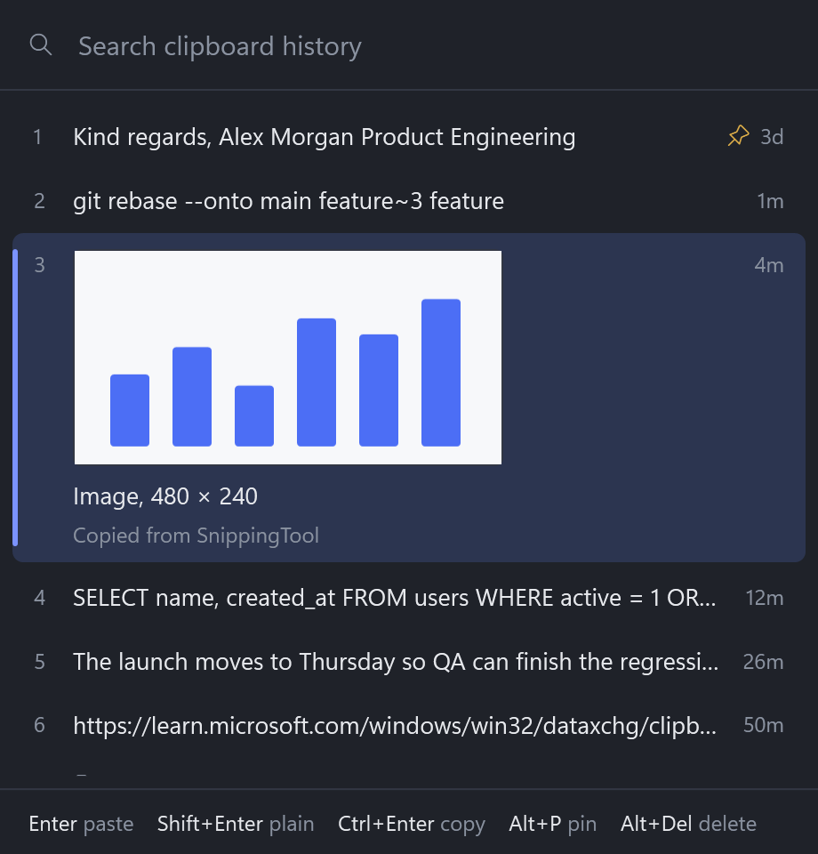
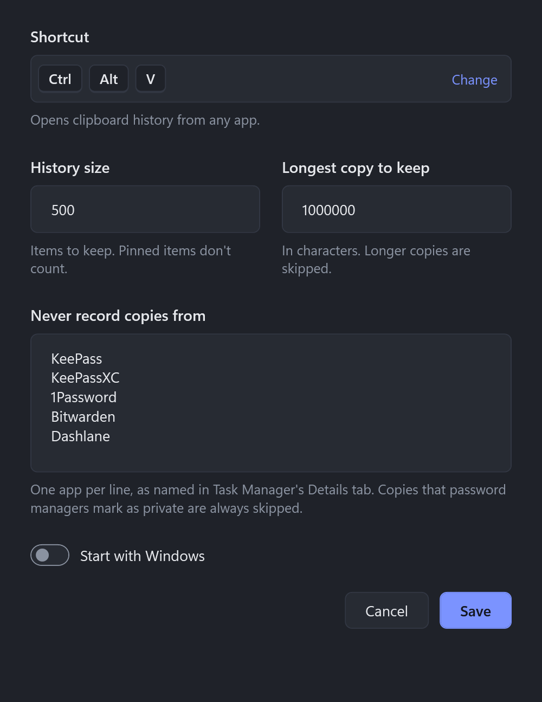

# WinClip

[](https://buymeacoffee.com/slimabbadi)

A keyboard-first clipboard history for Windows.

Press **Ctrl+Alt+V** anywhere, type a few letters, and press **Enter** to paste into the app you were using.

<p align="center">
  
</p>

## Features

- **Text, images and files.** Formatting from Word, browsers and Excel is kept. Screenshots show as thumbnails. Files copied in Explorer paste back as files.
- **Fast search.** Substring matches first, then fuzzy matches, so `gtrb` finds `git rebase`.
- **Pins.** Pinned items stay at the top and are never trimmed or cleared.
- **Pastes where you were typing.** The popup opens at the text cursor in apps that report it (otherwise at the mouse), and the chosen item is pasted into the app you came from.
- **Private by default.** History is encrypted with your Windows account, password-manager copies are skipped, and you can pause recording or exclude apps.
- **Light.** A tray app with no account and no telemetry.
- **Updates.** Checks GitHub Releases automatically, downloads new versions, and lets you restart when ready.

## Install

> WinClip is early software. Expect rough edges, and please [report problems](https://github.com/slimabbadi/winclip/issues).

WinClip is built for Windows 11 on 64-bit PCs. Windows 10 should work but is untested.

Starting with version 0.2.0, downloads use Velopack packaging:

1. Download **`WinClip.App-win-Setup.exe`** from [Releases](https://github.com/slimabbadi/winclip/releases) and run it. It includes .NET and installs for your Windows account.
2. Alternatively, extract **`WinClip.App-win-Portable.zip`** to a permanent, writable folder and run `WinClip.exe` there. Keep all the extracted files together; they are needed for updates.
3. WinClip lives in the tray. Turn on **Start with Windows** in Settings to start it when you sign in.

Older releases provide standalone exe files. Those copies cannot update themselves: quit the old copy before installing the new package. Your existing history and settings are reused. Replace any old shortcuts, and enable **Start with Windows** again from the new copy if you used it before.

The exe isn't code-signed yet, so Windows SmartScreen will warn that it's from an unknown publisher. Choose **More info**, then **Run anyway**. Each release lists SHA-256 checksums if you want to verify the download.

### Build from source

With the [.NET 10 SDK](https://dotnet.microsoft.com/download/dotnet/10.0):

```powershell
git clone https://github.com/slimabbadi/winclip.git
cd winclip
pwsh scripts\publish.ps1
```

This builds `dist\WinClip.exe` and adds **WinClip** shortcuts to the Start Menu and Desktop. Starting it again while it runs opens Settings. Pass `-SelfContained` for an exe that runs without .NET installed.

## Keys

| Key | Action |
|---|---|
| Ctrl+Alt+V | Open history (change it in Settings) |
| Type | Filter |
| Up / Down | Move the selection |
| Enter | Paste into the previous app |
| Shift+Enter | Paste as plain text (file items paste their paths) |
| Ctrl+Enter | Copy without pasting |
| Ctrl+1 … Ctrl+9 | Paste that row |
| Alt+P | Pin or unpin |
| Alt+Del | Delete the item |
| Esc | Close |

Opening history from the tray icon copies instead of pasting, because clicking the tray takes focus away from your app.

## Settings



Open **Settings…** from the tray icon menu. Changes apply when you click **Save**.

- **Shortcut:** click the box and press the new combination. If another app already uses it, Settings says so and keeps the old one.
- **History size** and **Longest copy to keep** limit what is stored.
- **Never record copies from** lists apps by process name.
- **Start with Windows** starts WinClip quietly when you sign in.
- **Check for updates automatically** checks shortly after startup and every 24 hours while running. Turn it off to stop scheduled checks. A check already in progress can finish.

Settings are saved to `%LOCALAPPDATA%\WinClip\settings.json`.

**Delete all local data…** in Settings removes all history including pins, settings, and logs after confirmation, turns off Start with Windows, and quits. Cancel leaves the data intact. The Windows clipboard and unrelated files you placed in the data folder are left alone. This removes WinClip's files; it does not guarantee forensic erasure from SSDs, backups, or filesystem snapshots.

<br clear="right">

## Privacy

See the [privacy policy](PRIVACY.md) for storage, network activity, retention, and deletion details.

- Copies marked private are never recorded. Most password managers mark them with `ExcludeClipboardContentFromMonitorProcessing`, `Clipboard Viewer Ignore`, or `CanIncludeInClipboardHistory = 0`.
- **Pause recording** in the tray menu stops recording until you turn it off or restart WinClip.
- History lives in `%LOCALAPPDATA%\WinClip\history.db`. Text, images and formatting are encrypted with Windows DPAPI, so only your Windows account can read them. Duplicate detection uses a keyed hash, so the file doesn't reveal whether it contains a guessed value. Deleted items are overwritten, not just unlinked.
- Not encrypted: which app each item came from, and when it was copied.
- Update checks contact GitHub and its download hosts. Clipboard history is never sent. Manual **Check for updates…** works even when automatic checks are off.

## Updates

Use **Check for updates…** in the tray menu to check and download a newer version. When ready, choose **Restart to update to …**, or click the update notification. If you keep working, the downloaded update is applied the next time you start WinClip after quitting it.

Alpha builds receive prereleases as well as stable releases. Stable builds receive stable releases only. Source builds and older standalone exe downloads require a manual installation to join the update system.

The installed app uses `%LOCALAPPDATA%\WinClip.App`; history and settings stay in `%LOCALAPPDATA%\WinClip`. Uninstalling the app leaves that data in place. Portable packages also use this shared data folder.

## Known limits

- Windows blocks simulated keystrokes into apps running as administrator unless WinClip also runs as administrator. In those apps, the item is copied but not pasted.
- Chromium, Electron and most terminals don't report their text cursor, so the popup opens at the mouse there.
- When text and a picture are copied together, as Excel does, WinClip keeps the text and its formatting, not the picture.
- Images larger than 32 MB as PNG are skipped.

## Development

```powershell
dotnet build WinClip.slnx
dotnet test WinClip.slnx
dotnet run --project src/WinClip
# Opens a temporary WPF window to verify scrolling and virtualization:
dotnet run --project tests/WinClip.UiSmoke -c Release
```

| Path | Contents |
|---|---|
| `src/WinClip.Core` | History storage, search, settings. Platform-neutral and unit-tested. |
| `src/WinClip` | The WPF app: Win32 clipboard listener, global shortcut, paste, tray, popup, settings. |
| `tests/WinClip.Tests` | xUnit tests for Core. |
| `scripts/publish.ps1` | Builds `dist\WinClip.exe` and creates shortcuts. |
| `scripts/release.ps1` | Builds an installer, portable zip, full update package, and SHA-256 checksums. |
| `scripts/e2e-smoke.ps1` | End-to-end test on the real desktop. It types for you, so leave the keyboard alone while it runs. |
| `scripts/make-icon.ps1` | Regenerates the app icon. |

### Package a release

```powershell
pwsh scripts/release.ps1 -Version 0.2.0-alpha.1
```

Files appear in `artifacts/release-0.2.0-alpha.1/packages`. The script restores the pinned Velopack CLI and builds a self-contained x64 app. It refuses to overwrite an existing output directory. Releases currently use full update packages rather than deltas.

Push a version tag such as `v0.2.0-alpha.1` to run `.github/workflows/release.yml`. It builds and tests before packaging, uploads a workflow artifact, creates a draft GitHub release, adds checksums, then publishes it. Versions containing `-` are marked as prereleases. If upload fails, the release stays a draft; inspect it before retrying. Published tag names must be unique.

To test packaging without publishing, run the workflow manually with a version. Local builds and GitHub Actions use the same packaging script. Source commits, tool versions, and checksums identify releases; the binaries are currently unsigned. Future tag publication is blocked until trusted signing is configured. See the [code signing plan](docs/code-signing.md).

Run **Verify lifecycle** in GitHub Actions to test the published 0.2.0 installer against a candidate update on a fresh hosted Windows runner. It checks encrypted history and pin retention, bundled-runtime loading, update download/apply/restart, deletion cancellation and confirmation through the real Settings window, and uninstall data retention. The runner has an SDK installed, so bundled-runtime loading is checked directly rather than claiming a machine without .NET. The previous app is stopped before applying the update; a handoff while active history writes are queued still needs separate coverage. The script refuses to run on your workstation or over existing WinClip data.

## Support

WinClip is free. If it saves you time, you can buy me a coffee. You'll also find this link in the tray menu and in Settings.

<a href="https://buymeacoffee.com/slimabbadi"></a>

## License

[MIT](LICENSE)
